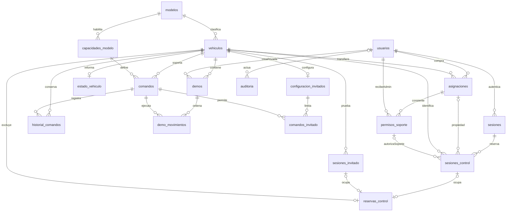

# Arquitectura integrada 4.3

El navegador usa HTML5, Bootstrap 5, CSS y módulos ES; consulta FastAPI por
REST HTTPS y WS seguro. Sólo FastAPI accede a MySQL/RDS mediante PyMySQL y
procedimientos. La sesión de la aplicación es distinta del usuario SQL.
Tokens opacos en memoria del navegador; RDS conserva sus hashes, expiración y
revocación. Contraseñas de aplicación con scrypt y sal individual.

Diagrama conceptual del esquema hasta 020. Las dos alternativas de titular de
`reservas_control` son excluyentes por CHECK. La PK de la unidad impide dos
reservas. `sesiones_control.id_asignacion` es nullable desde 019: la empresa
opera inventario sin propietario; comprador/soporte conservan asignación.
Las FK y sus nombres exactos se obtienen con `inventariar_rds.py --administrador`.
Los tokens no forman parte de los informes de pruebas.

| Rol/contexto | Permiso operativo |
| --- | --- |
| Empresa sobre unidad sin comprador | Reserva exclusiva propia y canal autenticado para movimiento/demo; gestión de inventario y demos EMPRESA. |
| Comprador | Sus unidades y demos PRIVADAS; consulta/ejecución de EMPRESA; reserva exclusiva antes de operar. |
| Administrador sobre unidad vendida | Consentimiento MONITOREO o consentimiento OPERATIVO temporal del propietario; este último además exige reserva propia. No accede a demos privadas. |
| Invitado | Catálogo publicado y sesión temporal en exhibición; lista reducida, pulsos y reserva exclusivos. |

Las modificaciones se validan en SQL y FastAPI. Las identidades usadas de
comandos/capacidades no cambian al editar. Las bajas son lógicas. Las demos
persisten pasos con revisión para evitar sobrescritura concurrente.
DETENER interrumpe demos; pasos internos y cierre de demo no se agregan al
historial individual. Los diez individuales se ordenan por fecha e ID.

La liberación pasa por DETENIENDO, procesa DETENER y sólo entonces libera. Un
fallo conserva el bloqueo para recuperación. Caducar un token no roba una
reserva. El worker recupera reservas al arrancar. Requiere **un proceso/worker**:
canales, tareas de demo y límites de tasa tienen estado local en memoria.

Login: 12 intentos por cuenta y 30 por dirección en 60 s, respuesta 429 y
Retry-After; máximo 10 000 claves con rechazo de nuevos intentos si se llena.
No se almacena contraseña ni correo en los buckets. Reiniciar el proceso
reinicia esos límites; para múltiples procesos se necesitaría estado compartido
además de rediseñar los canales. Invitado conserva 10 reservas/min por dirección
y 4 comandos/s por sesión, con sus límites temporales configurados.

El catálogo muestra únicamente capacidades activas de modelos publicados y un
asset SVG genérico identificado como ilustración. No afirma ser fotografía del
producto. La disponibilidad se vuelve a validar al reservar. El resumen cuenta
demos EMPRESA activas; no revela contenido de demos privadas.

Listas administrativas recorren páginas API de 100 para completar tablas y
selectores. La tabla busca en la colección cargada y pagina visualmente de 20.
Esto evita truncar a 100; para inventarios grandes conviene búsqueda/paginación
remota, pues hoy el navegador carga la colección completa.
