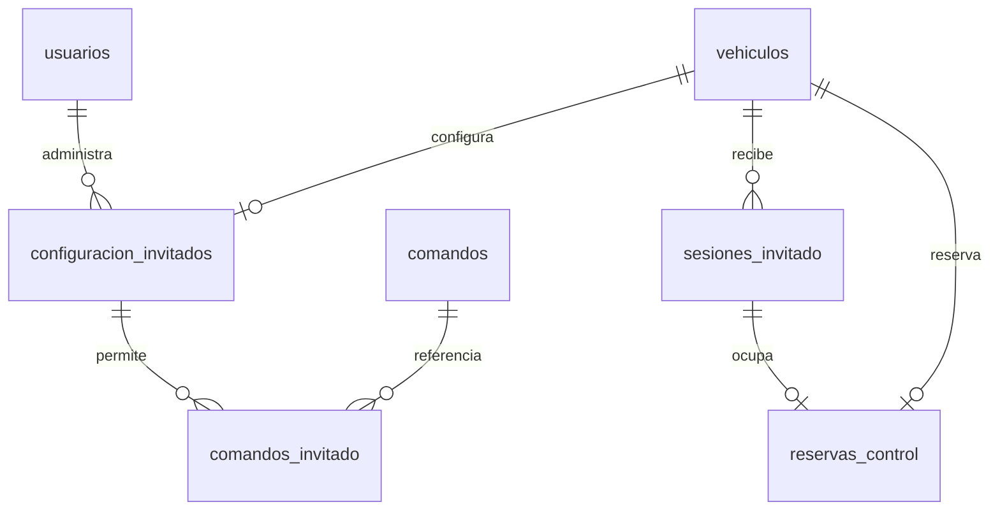

# Plan de ampliación 4.3

## Base verificada

Inventario de RDS recibido el 21 de noviembre de 2026. Esquema
`vehiculo_iot`, MySQL 8.4.9, seis tablas InnoDB y 21 procedimientos
`SQL SECURITY DEFINER`, definidos por `admin@%`.
La cuenta `iot_api@%` tiene EXECUTE en el esquema.

| Tabla existente | Uso y relaciones |
| --- | --- |
| vehiculos | Unidad física identificada por id_vehiculo. modelo es texto. |
| comandos | Comandos de cada unidad. Nombre y código únicos por unidad. |
| estado_vehiculo | Estado único por vehículo y referencia al comando. |
| historial_comandos | Registros por vehículo y comando. Orden por fecha_hora e id_historial descendentes. |
| demos | Cabecera de secuencia vinculada a una unidad. |
| demo_movimientos | Pasos vinculados a demo y comando. Orden único dentro de cada demo. |

Los procedimientos de eliminación actuales ejecutan DELETE. La ampliación
administrativa necesita baja lógica de unidades y comandos para conservar
historial. La compatibilidad de los procedimientos se revisará en la copia de
prueba antes de preparar cambios.

## Diseño propuesto para revisión

Los nombres siguientes son propuestas de tablas y campos.

| Componente | Propuesta |
| --- | --- |
| Cuentas y clientes | usuarios con identificador, correo único, nombre, hash de contraseña, rol validado y activo. El comprador utiliza la misma cuenta que su ficha de cliente. |
| Sesiones | sesiones con usuario, hash del token, caducidad y revocación. Login y logout validados por FastAPI. |
| Modelos | modelos con nombre, descripción, activo y capacidades. |
| Unidades | Extender vehiculos con id_modelo, identificador comercial único y estado comercial. Mantener id_vehiculo como ID de CONTROL y MONITOREO. |
| Propiedad | asignaciones con fechas de inicio y fin para mantener historial. Una relación de propiedad vigente única por unidad, protegida por restricción y transacción. |
| Capacidades | capacidades_modelo como catálogo del modelo. comandos mantiene el enlace de cada comando con su unidad física. Validar ambos niveles al ejecutar. |
| Demos | Extender demos con propietario y tipo empresa/privada. Reutilizar demo_movimientos y validar que cada comando pertenezca al vehículo de la secuencia. |
| Reservas | Una reserva operativa vigente por unidad, compartida por Usuario, soporte e Invitado. Adquisición transaccional con bloqueo por unidad y expiración. |
| Invitados | Sesión temporal con token almacenado como hash, unidad de exhibición, caducidad, comandos permitidos y estado. |
| Soporte | Autorización explícita del comprador con administrador, unidad, vigencia y revocación. |
| Auditoría | Actor, acción, recurso, resultado y fecha UTC. Redactar secretos y datos privados innecesarios. |

Los vehículos actuales requieren clasificación comercial explícita. El primer
administrador se creará con un comando de servidor y contraseña introducida
localmente. El diseño definitivo y los scripts SQL se preparan después de
obtener el DDL exacto y validar el respaldo en una copia.

## Autorización y ejecución

FastAPI validará identidad, rol, unidad y reserva antes de cada acción.
Usuario ve sus unidades. Invitado recibe catálogo público y una sesión de
exhibición. Administrador gestiona inventario y usa soporte operativo mediante
permiso explícito.

WSS necesita autenticar y autorizar suscripciones. Cambios de dueño, expiración
y revocación deben cerrar acceso y liberar o detener reservas. La API key
compartida actual requiere un plan de transición para que no permita eludir
los nuevos permisos. Los clientes web y el firmware se revisan antes de
desactivar o restringir el mecanismo anterior.

Las reservas vencidas y desconexiones requieren detención en el servidor y
un temporizador de seguridad en firmware para cubrir cortes completos de red.
La confirmación física se probará con el circuito disponible.

## Entregas y comprobaciones

1. Respaldo SQL con tablas, datos, procedimientos y metadatos de integridad.
   Restauración en una base aislada y comparación de conteos y relaciones.
2. Migraciones versionadas revisadas sobre el DDL real. Aplicación en prueba,
   validaciones de integridad y plan de recuperación por respaldo.
3. Backend modular con cuentas, sesiones y permisos por recurso.
   Verificación de 401/403, aislamiento entre compradores y WSS autorizado.
4. Administración con inventario, clientes, asignaciones y métricas reales.
5. Mis vehículos y editor de demos persistentes con pasos ordenados.
6. Invitados, soporte, reservas exclusivas, caducidad y DETENER.
7. Regresión de CONTROL/MONITOREO, publicación en el repositorio original y
   pruebas cruzadas de las tres plataformas con la matriz de la consigna.

## Datos pendientes

- Validación de las migraciones en la copia restaurada. El respaldo y el DDL
  exacto ya se recibieron y revisaron.
- Copia actual del backend de Windows Server para contrastarla con el código local.
- Clasificación comercial y propietario inicial de la unidad 1.
- Nombre y correo del primer administrador cuando se prepare su alta.

El respaldo vehiculo_iot_20261121-203540-777513.sql se restauró en
iot_prueba_20261121_205613_303067. La ejecución compartida por el usuario
confirma conteos iguales en origen y copia y los mismos nombres de los
21 procedimientos. Se conservaron 13 comandos, nueve pasos, dos demos,
un estado, 306 registros de historial y un vehículo.

Esta comprobación cubre restauración, conteos y presencia de procedimientos.
Las pruebas de integridad referencial, comparación de definiciones y regresión
de APIs sobre la copia se realizarán al validar las migraciones.

## Migración 001 preparada

`sql/migrations/001_base_administracion.up.sql` añade usuarios, modelos,
asignaciones y el registro de migración. Extiende vehiculos con id_modelo,
identificador_unidad y estado_comercial. El estado inicial PENDIENTE permite
clasificar la unidad después de revisar propietario y uso de exhibición.
Las nuevas tablas empiezan vacías.

`tools/migrar_copia_rds.py` acepta únicamente copias con el formato generado
por la verificación del respaldo. Exige las seis tablas originales, captura
los valores de sus columnas actuales y las definiciones de procedimientos
antes y después, y guarda el resultado fuera del contenido público.

La migración 001 se ejecutó en iot_prueba_20261121_205613_303067.
La salida compartida por el usuario confirma código MySQL 0 y comparación
de datos y procedimientos conservados=True. Las diez tablas esperadas están
presentes. El informe del servidor es migracion_001_20261121-210425-084695.json.
El usuario ejecutó probar_migracion_001.py y compartió siete resultados
correctos: altas transaccionales de un administrador y dos compradores,
asignación, rechazo de propietario vigente duplicado, reasignación y consulta
por sp_obtener_vehiculo. Las filas de prueba se revirtieron. Informe
prueba_001_bfe8960a23dd409eadac0c6b500bcaa1.json.
Ante DDL parcial, revisar los
objetos creados. Para recuperar el entorno de prueba se puede restaurar el
respaldo en otra copia nueva mediante verificar_respaldo_rds.py y conservar la
copia fallida para diagnóstico. La reversión conserva el respaldo original
como fuente de recuperación. Las etapas posteriores tienen pendiente sesiones,
capacidades, soporte, invitados, reservas, auditoría y metadatos de demos.

La propuesta 002 añade sesiones revocables con hashes de tokens y auditoría
de acciones. Se ejecutó en la copia con código MySQL 0 y conservación
de datos/procedimientos originales confirmada por el usuario.
Se crearon sesiones, auditoria y los cuatro procedimientos sp_auth_*.
Informe migracion_002_20261121-212018-297435.json.
El ZIP backend_revision_4_3.zip fue revisado e incorporado en backend/.
main.py contiene CORS para el origen GitHub Pages. Los módulos de movimientos
y ejecución de demos coinciden con la copia local. config.py y database.py se
reutilizaron de la copia local y requieren contraste antes del despliegue.

Se prepararon /auth/login, /auth/me y /auth/logout, hashes scrypt con sal
individual y sesiones de una hora con tokens opacos y hash SHA256 en RDS.
La creación de sesión y su auditoría se confirman en una transacción.
La autenticación usa los procedimientos sp_auth_* de la migración 002.

Siete pruebas locales pasaron con el acceso a datos sustituido por dobles
controlados. Cubren hashes, credenciales erróneas, cuenta inactiva, ausencia
de sesión, sesión rechazada por el repositorio, creación y cierre.
La validación SQL de expiración/revocación y las pruebas de integración real
permanecen pendientes. Las dependencias instaladas para esta revisión local
pueden diferir de las versiones del requirements.txt recibido del servidor.

Esta entrega prepara autenticación. Los endpoints REST/WSS anteriores todavía
usan su esquema de acceso original y quedan pendientes de autorización por
recurso. El despliegue de la plataforma multiusuario requiere completar esa
transición, el control de intentos de login, la provisión del administrador y
el aislamiento probado antes de habilitar usuarios externos.

El usuario creó el primer administrador de aplicación en la copia mediante
crear_admin_prueba.py. Reportó creación, lectura y revocación de sesión SQL
correctas y cuenta confirmada. Las pruebas HTTP están pendientes.

El paquete backend de prueba se inicia con iniciar_prueba.py y enlaza
127.0.0.1:8001. Carga el .env existente y selecciona la copia por argumento.
La cuenta iot_api requiere EXECUTE explícito en esa copia para llamar sus
procedimientos; habilitar_prueba_rds.py concede ese permiso al esquema de prueba.

El usuario confirmó HTTP 200 de login y resultados esperados de /auth/me,
/auth/logout y rechazo 401 al volver a usar la sesión revocada en el backend
aislado. La integración básica de autenticación está comprobada con RDS.

Se preparó la migración 003 con consultas de resumen, modelos, compradores y
unidades y altas de modelos y compradores con auditoría transaccional.
Las rutas /admin requieren require_admin. La suite local acumula trece pruebas
correctas con repositorios simulados, incluidas respuestas 401, 403, 409 y 422.
El usuario ejecutó 003 en la copia y reportó código MySQL 0 y conservación
de datos/procedimientos originales=True. Informe
migracion_003_20261121-214759-525694.json. Las pruebas HTTP de Administración
están pendientes de realizar con el paquete backend de prueba actualizado.
El usuario confirmó GET de resumen, unidades y modelos con HTTP 200, altas
de modelo y comprador correctas, login del comprador, /auth/me con rol USUARIO
y rechazo 403 en /admin/resumen.

La migración 004 y sus rutas están preparadas para configurar modelo e
identificador de una unidad, asignarla/reasignarla y consultar /mis-vehiculos.
Las escrituras se confirman junto con auditoría. El procedimiento de asignación
bloquea la fila de unidad y comprueba comprador activo y propietario vigente.
El usuario ejecutó SQL 004 en la copia y reportó código MySQL 0 y
conservación de datos y procedimientos originales=True. Informe
migracion_004_20261121-220924-791526.json. Las comprobaciones HTTP de
configuración y asignación fueron realizadas por el usuario. Modelo 3
Montacargas RC, comprador 5 y unidad 1 con identificador MONT-001.
El GET /mis-vehiculos autenticado como comprador devolvió esa unidad
con estado ASIGNADO. Queda pendiente comprobar otro comprador sin unidades
y completar autorización en rutas operativas REST y WSS.
El usuario confirmó un segundo comprador con /mis-vehiculos vacío.

Se preparó 005_acceso_recursos y el modo IOT_AUTH_MODE=sesiones, activado por
iniciar_prueba.py. Las rutas anteriores requieren sesión y comprueban la unidad
de vehículos, comandos, demos y pasos. La API key por sí sola se rechaza en
este modo. El administrador conserva inventario pero requiere soporte futuro
para operar una unidad asignada. El CRUD de demos permanece restringido al
administrador hasta incorporar propiedad privada de demos.

El socket acepta Authorization Bearer o un primer mensaje
{"tipo":"autenticar","token":"TOKEN_DE_SESION"}. Valida antes del estado inicial,
revalida cada dos segundos y antes de enviar eventos. La revocación o pérdida
de propiedad cierra el acceso. El frontend y firmware actuales requieren la
adaptación de autenticación antes del despliegue público de este modo.

La suite local de 24 pruebas pasó con repositorios simulados. Las nuevas
comprobaciones HTTP y WSS reales están pendientes de aplicar SQL 005.
El usuario aplicó SQL 005 con código MySQL 0 y conservación=True. Después de
corregir la declaración HTTPBearer en Swagger confirmó 403 al consultar
/vehiculos/1/estado como Comprador B y 200 como comprador propietario.
La comprobación real del socket autenticado continúa pendiente.

Se preparó 006 para edición/baja lógica de modelos y compradores y consulta
de auditoría. La desactivación de un comprador revoca sus sesiones dentro
de la misma transacción. Desactivar un modelo con unidades activas se rechaza.
La ejecución MySQL y las pruebas HTTP de 006 están pendientes.
El usuario aplicó SQL 006 y confirmó código MySQL 0 y conservación=True.
Informe migracion_006_20261121-232408-192388.json.
Se preparó probar_admin_http.py para las comprobaciones de 006 por HTTP:
crear/duplicar/desactivar modelo, crear/desactivar comprador, revocar su sesión
y comprobar la auditoría. Crea registros de prueba identificables y los deja
inactivos al completar exitosamente la secuencia. La ejecución está pendiente.
El usuario ejecutó probar_admin_http.py y confirmó todas las comprobaciones,
incluidas respuestas 201/409/200 en modelos, creación y desactivación del
comprador, rechazo 403 en auditoría, revocación 401 y cuatro acciones
persistidas en auditoría. Informe http_admin_d62c162e21b0.json.
Se preparó probar_acceso_wss.py para completar la validación real de
aislamiento REST/WSS y cierre del socket al revocar una sesión.
El usuario compartió la ejecución correcta de probar_acceso_wss.py.
Se verificaron cuentas distintas, propiedad de la unidad 1, lista vacía
del segundo comprador, GET de estado/historial/comandos con 200 para dueño
y 403 para Comprador B, WSS rechazado antes del estado para Comprador B,
estado inicial WSS para dueño, logout y cierre del socket tras revocación.
Informe prueba_wss_20261122-010410-849588.json.

Siguiente bloque funcional: demos privadas con propietario, listado filtrado,
editor de pasos compatible con comandos de la unidad y guardado atómico.
La siguiente migración deberá preservar las dos demos existentes como demos
de empresa, mantener los nueve pasos actuales y validar que la reasignación
de un vehículo no exponga demos privadas de su propietario anterior.

## Entrega 007 preparada

007_editor_demos añade tipo EMPRESA/PRIVADA, propietario y revisión.
Los registros previos reciben tipo EMPRESA y revisión 1. Los tres procedimientos
sp_editor_* resuelven visibilidad y guardan cabecera y secuencia en la misma
transacción, con comprobación de usuario y propiedad y bloqueo de la unidad.
El guardado rechaza revisiones antiguas, comandos inactivos o ajenos y demos
anidadas. La API protege edición mientras hay una demo ejecutándose en el
proceso actual.

Límites iniciales elegidos para el editor: 100 pasos, 10000 ms por movimiento,
5000 ms por pausa y 120000 ms por secuencia. Son límites de software
conservadores configurados para esta entrega y deben contrastarse con el
hardware antes de ejecutar físicamente secuencias.

Rutas preparadas: GET/POST /mis-demos, GET /mis-demos/{id_demo} y
POST /mis-demos/{id_demo}/guardar. La consulta exige id_vehiculo.
Las rutas previas de edición individual de pasos, en modo sesiones, remiten
al editor de secuencia completa para mantener revisiones y propiedad.
La consulta previa de demos y el inicio de ejecución filtran visibilidad.

La suite de 34 pruebas locales pasó. probar_editor_demos.py está preparado
para crear, leer, editar y desactivar una demo privada de DETENER sin iniciar
su ejecución; verifica ocultación al segundo comprador, conflicto de revisión
y rechazo de un comando ajeno conservando la secuencia guardada.
La comprobación real descubrió una inversión de id_comando/orden al insertar
pasos. La migración 008 reemplaza sp_editor_guardar_demo y corrige 007 para
instalaciones nuevas. Se conservó el índice único de orden por demo.

## Validación real de la corrección 008

El usuario confirmó código MySQL 0 y conservación de datos/procedimientos.
La prueba reanudada sobre demo 3 pasó guardado completo, ocultación al otro
comprador, rechazo de revisión antigua, rechazo de comando incompatible,
conservación de secuencia y desactivación de la demo de prueba.
Informes del servidor: migracion_008_20261122-014130-719759.json y
prueba_editor_8080db762b0d.json.

## Interfaz 4.3 en preparación para pruebas aisladas

La vista Mi cuenta integra login, menú por rol, resumen, modelos, compradores,
configuración y asignación de unidades, auditoría, vehículos del comprador
y editor visual de demos. La selección de unidad conecta control/monitoreo
mediante sesión Bearer y autenticación del primer mensaje del WebSocket.
Las credenciales y tokens se mantienen solamente en memoria de la pestaña.
Cambiar de cuenta limpia catálogo e historial y cierra el socket previo.

El paquete frontend_4_3_prueba.zip usa localhost:8001 y modo sesiones.
El config.js del repositorio conserva el modo API key de producción hasta
publicar el backend de sesiones. La interfaz nueva aún requiere validación
con las cuentas reales en el servidor Windows. Quedan pendientes los demás
requisitos 4.3, la regresión de ejecución y el despliegue final.

Comprobaciones locales de interfaz: sintaxis de todos los módulos JavaScript,
ZIP íntegro y sin auth.local.js, pantalla de acceso en escritorio y viewport
390 px sin desbordamiento, error de conexión recuperable al enviar el login
con el backend apagado. La revisión horizontal posterior quedó interrumpida
por desconexión del servidor de vista previa. No se verificaron formularios
autenticados localmente contra el servidor Windows.

## Validación del frontend comunicada por el usuario

El usuario compartió capturas de login administrador, resumen, modelos,
unidades, compradores y auditoría con datos reales de la copia. Como comprador
propietario confirmó listado MONT-001, carga del control y demos. Confirmó
crear una demo desde la web, modificar la duración, recuperar el cambio y
ejecutarla con evento DEMO finalizada. Comprador B conserva lista vacía.
El historial de diez individuales sigue el contrato previo: los pasos internos
de demos no se insertan como individuales. La consigna 9.5 exige respetarlo.
Los ajustes visuales se posponen por indicación del usuario.

## Entrega 009 de inventario preparada

La revisión de requisitos 7.2/7.5 y P02 detectó que faltaba el alta de unidad
comercial desde la aplicación. 009 crea sp_admin_crear_unidad y
sp_admin_actualizar_unidad y amplía la consulta administrativa con descripción
y microcontrolador originales. No altera las seis tablas ni los 21 SP previos.
El identificador sigue protegido por el UNIQUE de 001. Alta/edición y auditoría
se confirman en una misma transacción. El campo modelo legacy conserva hasta
80 caracteres; la referencia id_modelo y nombre_modelo comercial es completa.

POST /admin/unidades registra nombre, id_modelo, identificador_unidad,
descripcion y microcontrolador y devuelve id_vehiculo con HTTP 201.
POST /admin/unidades/{id}/actualizar recibe además activo, realiza edición
completa y baja lógica con HTTP 200. Admin y validación Pydantic protegen ambas.
La UI incorpora Nueva unidad, Editar, estado activo/inactivo y búsqueda sobre
las 100 unidades cargadas. La paginación REST preexistente se conserva;
la navegación de páginas y filtros completos siguen pendientes en la UI.

Las unidades nuevas no heredan comandos ni declaran conectividad física.
Una unidad asignada conserva modelo y estado activo; la baja de unidades
vendidas requiere completar la detención/reservas y el flujo comercial.
No se cambia el modelo de unidades con comandos/demos sin revisar capacidades.
Se rechaza editar durante una demo en ejecución. La ruta antigua /configurar
queda obsoleta y responde 409 hacia el documento completo. En modo sesiones
las escrituras legacy /vehiculos remiten a /admin/unidades para impedir
eludir estas validaciones. El modo legacy conserva su comportamiento.

43 pruebas locales del backend pasaron, incluidas nueve de inventario.
La validación SQL real de 009 queda pendiente. probar_inventario_http.py crea
un modelo, dos unidades y un comprador nuevos; comprueba duplicados,
persistencia, permisos, bajas, rechazo de asignación inactiva y auditoría.
Deja los registros nuevos inactivos y no modifica la unidad 1 ni sus comandos.
Guarda resultados privados en respaldos_rds y cierra las sesiones de prueba.

Recuperación ante DDL parcial: conservar informe del ejecutor y examinar los
procedimientos nuevos y sp_admin_listar_unidades antes de reintentar. La
definición anterior de listado está en 003_gestion_comercial.up.sql; restaurar
sólo esa rutina con el backend/frontend anterior permite volver a la versión
previa. No ejecutar 003 completa sobre una base ya migrada. La migración no
cambia filas, pero no se confía en ROLLBACK para deshacer sus CREATE/DROP.

## Validación real de 009

El usuario confirmó migracion_009_20261122-025030-188422.json, MySQL 0 y datos
y procedimientos conservados. Ejecutó probar_inventario_http.py y pasó todos
los resultados previstos: altas, edición, duplicados, conservación tras rechazo,
401/403, bajas lógicas de unidades nuevas 3 y 4, rechazo de asignación inactiva
y auditoría. Informe http_inventario_257cb1811281.json. Confirmó actualizar el
frontend y ver Nueva unidad, Editar, búsqueda y unidades de prueba inactivas.

## Entrega 010 de catálogo preparada

Primer bloque de Invitados (requisito 10.1). Añade modelos.publico con valor
inicial 0 y publicación explícita por administrador. No publica registros
existentes durante la migración. POST /admin/modelos/{id}/publicacion recibe
publico; POST /admin/unidades/{id}/exhibicion recibe habilitada. Esta última
exige unidad activa sin propietario y modelo activo publicado. Conserva los
historiales y registra ambas operaciones junto con la auditoría en transacción.
La configuración de exhibición se rechaza durante una demo en ejecución.

GET /catalogo es anónimo y paginado. Sólo devuelve id_modelo, nombre,
descripcion y unidades_exhibicion de modelos activos publicados. Su conteo
excluye unidades inactivas, estados distintos a EXHIBICION y cualquier unidad
con asignación vigente, incluso si su estado comercial fuera inconsistente.
El conteo representa inventario comercial; no confirma hardware conectado ni
reservas disponibles. El esquema Pydantic evita filtrar columnas privadas.

La interfaz incorpora Explorar catálogo público en Mi cuenta, Publicar/Retirar
en Modelos y Usar/Retirar exhibición en unidades activas sin propietario.
El catálogo permite navegar páginas y avisa que las pruebas de control todavía
no están disponibles. Las reservas exclusivas, los tokens temporales, el reloj,
comandos limitados, soporte y detención por caducidad continúan pendientes.
La unidad 1 permanece asignada al comprador; no se cambia su clasificación.

53 pruebas locales pasaron. Incluyen contrato público sin campos privados,
permisos, sanitización de errores, paginación y ejecución del SELECT real del
catálogo sobre una base SQLite desechable para comprobar filtros. Esto no
verifica instalación de procedimientos ni bloqueos de MySQL. La migración
010 y probar_catalogo_http.py requieren ejecución real en la copia de RDS.
El script crea un modelo y una unidad nuevos, comprueba publicación/retiro,
conteos, rechazo de exhibición privada/asignada y auditoría. Comprueba que la
unidad 1 sigue asignada antes de intentar la operación que debe rechazarse,
y que el inventario de esa unidad permanece idéntico después. No envía
movimientos. Los registros nuevos quedan privados e inactivos al finalizar.

Recuperación ante DDL parcial: conservar el informe y revisar la existencia
de modelos.publico y de las nuevas rutinas antes de repetir el SQL. El backend
y frontend anteriores pueden restaurarse conservando la columna adicional;
el listado administrativo previo está definido en 003. No eliminar registros
ni volver a ejecutar migraciones anteriores completas. El despliegue público
de esta ampliación continúa pendiente de completar el flujo de Invitados.

## Ejecución real 010 y corrección del script

El usuario aplicó 010 con MySQL 0 y conservación=True. Informe
migracion_010_20261122-031031-050600.json. probar_catalogo_http.py pasó todas
las comprobaciones funcionales, incluidas publicación/retiro, conteos,
privacidad, rechazo de exhibición de unidad 1 asignada sin cambios, bajas
de unidad/modelo y auditoría. Informe http_catalogo_eec461b73ebc.json.

El script terminó con error de limpieza porque su bloque finally repetía
la baja de la unidad después de haber desactivado el modelo. La rutina 009
exige modelo activo y esa escritura redundante puede responder 409.
La corrección registra las bajas exitosas y evita repetirlas. No modifica
el backend ni necesita repetir las migraciones. Tres pruebas de regresión
con estado controlado verifican la secuencia completa y la comprobación de
resultados anteriores sin escrituras de inventario. La suite suma 56 pruebas.

La opción --verificar-informe consulta los IDs del informe anterior y guarda
un archivo .estado_verificado.json con publicación/actividad del modelo y
actividad, estado comercial y ausencia de propietario de la unidad de prueba.
Sólo inicia/cierra una sesión y lee inventario; no crea ni modifica esos
registros. La confirmación real del estado final está pendiente de esta lectura.

El usuario confirmó la lectura posterior: modelo privado e inactivo y unidad
inactiva sin propietario. El informe anterior mostró que el 409 era sólo la
baja redundante. Se guardó http_catalogo_eec461b73ebc.estado_verificado.json.
También confirmó actualizar el frontend y ver el catálogo público vacío.

## Entrega 011: base SQL de reservas de Invitado

Esta entrega prepara persistencia y transiciones; no publica nuevos endpoints
ni habilita control de Invitado en la web. Añade cuatro tablas:

| Tabla | Propósito |
| --- | --- |
| configuracion_invitados | Habilitación explícita, duración de sesión y máximo de pulso por unidad. |
| comandos_invitado | Lista de comandos existentes, activos y pertenecientes a la unidad. |
| sesiones_invitado | Hash SHA256 del token, fechas y motivo de cierre; conserva el historial. |
| reservas_control | Una reserva vigente por unidad mediante PK, con estado ACTIVA o DETENIENDO. |

La reserva exige unidad activa de exhibición, modelo activo publicado,
ausencia de propietario, configuración habilitada y DETENER activo permitido.
Bloquea la fila de unidad y modelo en transacción. Una reserva vencida no se
reutiliza automáticamente: se cierra la sesión, conserva el bloqueo durante
DETENIENDO y sólo se libera cuando el servicio de cierre procesa DETENER.
La función SQL de liberación es interna y no demuestra recepción física.
Las rutinas se deben invocar en transacciones desde el backend; no hacen COMMIT.

Límites de software iniciales elegidos: sesión de 15 a 120 s, pulso de 50 a
500 ms y entre uno y diez comandos con DETENER obligatorio. Son límites
conservadores de esta aplicación, no valores medidos del circuito. POWER y
DEMO quedan fuera de la lista permitida. No se inventan códigos de hardware.
La pertenencia del comando a su unidad se comprueba al configurar y consultar.

Cinco triggers impiden cambiar una unidad reservada, sus comandos, su
asignación o retirar/desactivar su modelo mientras exista la reserva.
La auditoría conserva configuración, reserva, cierre y liberación sin tokens.
Los registros de sesiones no se eliminan; se elimina sólo la ocupación temporal.
La ampliación de reservas a sesiones de comprador y soporte sigue pendiente.

Se instaló un servidor local desechable MariaDB 12.3.2, accesible únicamente
por socket privado. Se reconstruyeron las columnas originales desde el
inventario y se compilaron migraciones 001–011, sustituyendo únicamente en esa
prueba utf8mb4_0900_ai_ci por utf8mb4_unicode_ci. No equivale a probar MySQL
8.4.9 de RDS. Pasaron 30 comprobaciones SQL reales y la competencia de dos
conexiones: sólo una obtuvo la reserva y la otra fue rechazada con 1644.
La suite HTTP local anterior de 56 pruebas siguió pasando.

probar_reservas_sql.py usa datos nuevos dentro de una transacción y ROLLBACK.
No envía comandos REST/WSS ni cambia la unidad 1. Prueba límites, comandos,
exclusividad, triggers, expiración, cancelación, cierre, liberación y auditoría.
AUTO_INCREMENT puede avanzar. Falta aplicarlo y ejecutarlo en la copia RDS.

Antes de habilitar Invitados faltan los endpoints autenticados por token
temporal, control y WSS limitados, reloj, detección de desconexión, barrido de
reservas vencidas y detención al arrancar/recuperar el servicio. Las rutas
operativas actuales también deben respetar reservas para evitar intervención
de otra sesión. Deben verificarse de manera independiente la publicación del
evento DETENER y la reacción física, con temporizador de seguridad en firmware.

Recuperación ante DDL parcial: conservar informe y revisar las cuatro tablas,
siete rutinas sp_invitado_* y cinco triggers antes de reintentar. Los 21 SP y
registros originales se conservan. Para retirar esta ampliación sin pérdida
se pueden deshabilitar sus consumidores, conservar tablas/historial y revisar
los triggers añadidos. No se presupone reversión por ROLLBACK del DDL.

## 011 parcial en RDS: error 1419 y recuperación preparada

El usuario ejecutó 011 en RDS y reportó MySQL 1, conservación de datos/SP
originales=True y las 16 tablas presentes. La ejecución se detuvo en el primer
CREATE TRIGGER con ERROR 1419 por registro binario activo sin privilegio SUPER.
Informe migracion_011_20261122-034119-568602.json. La validación local MariaDB
sin binlog no había reproducido esta restricción específica de RDS.

AWS documenta el requisito y el parámetro de grupo log_bin_trust_function_creators:
https://docs.aws.amazon.com/AmazonRDS/latest/UserGuide/CHAP_Troubleshooting.html
No se modificaron permisos ni parámetros de AWS desde el agente. El ejecutor
general ahora comprueba binlog/trust antes de ejecutar DDL con CREATE TRIGGER.

recuperar_reservas_011.py compara el hash de la fuente contra el informe previo,
exige copia aislada, tablas esperadas, versiones previas y tablas de reservas
vacías. Compara las siete definiciones de rutina y cualquier trigger existente.
El modo --diagnostico sólo consulta. La recuperación crea únicamente triggers
faltantes y registra 011 después de verificar los cinco y conservar los datos
y procedimientos originales. No repite CREATE TABLE ni reemplaza rutinas.
Si sigue binlog activo con trust=0 se detiene antes de ejecutar DDL.

66 pruebas locales pasaron. Se recreó un estado parcial local sin triggers
ni registro 011 y se comprobó la CLI completa: diagnóstico sin cambios,
recuperación de cinco triggers y repetición sin duplicarlos. Se ignoran sólo
comentarios de línea y diferencias de espacio al comparar definiciones,
porque el motor puede omitir comentarios en ROUTINE_DEFINITION.
La recuperación real en RDS y la configuración del grupo de parámetros
continúan pendientes del diagnóstico y de la acción del usuario en AWS.

## Recuperación y validación real de 011 completadas

El usuario creó iot-mysql84-triggers (familia mysql8.4), lo asoció a
instancia-rds-iot y reinició RDS. Confirmó binlog=1 y trust_creators=1.
La recuperación creó los cinco triggers, registró 011 y confirmó conservación
de datos y SP. Informe recuperacion_011_20261122-042555-218510.json.
Después pasó las 30 pruebas SQL reales en RDS con ROLLBACK de los datos nuevos.
Informe reservas_sql_20261122-042713-470743.json. El usuario también confirmó
la interfaz del catálogo vacío. No se habilitó exhibición sobre la unidad 1.

## Entrega 012: API de Invitado preparada

Estimación de avance comunicada: alrededor del 65 % de la actividad completa,
considerando bloques comprobados y trabajo restante. No equivale a puntuación
de rúbrica ni confirma que la práctica esté lista para entregar.

012 añade nueve rutinas para identificar sesiones, consultar configuración y
unidades públicas, enumerar reservas, registrar un movimiento validado, pedir
DETENER, auditar cierre administrativo y exigir unidad libre en operaciones
normales. Reutiliza los SP originales de estado e historial sin modificarlos.
Los movimientos pedidos por Invitado se guardan como individuales MANUAL;
las paradas automáticas actualizan estado y emiten evento, sin añadir otro
registro individual. El guardado de movimiento y sus validaciones se realizan
en una transacción con bloqueo de unidad.

| Ruta nueva | Acceso y función |
| --- | --- |
| GET/POST /admin/unidades/{id}/invitados | Admin consulta/configura habilitación, duración, pulso y lista de comandos. |
| POST /admin/unidades/{id}/invitados/cerrar | Admin revoca la prueba de exhibición y audita su identidad. |
| GET /catalogo/{id}/unidades | Público; unidades configuradas de exhibición, ocupación y límites, sin datos de compradores. |
| POST /invitados/sesiones | Público limitado por solicitudes; reserva exclusivamente la unidad elegida. |
| GET /invitados/sesion | Bearer de Invitado; estado temporal y comandos permitidos. |
| POST /invitados/movimientos | Bearer de Invitado y canal WS conectado; sólo id_comando autorizado. |
| POST /invitados/sesion/cerrar | Bearer de esa sesión; cierre idempotente, incluso tras vencimiento. |
| WS /ws/invitados | Primer mensaje autenticar/token; unidad derivada de sesión, un canal por sesión. |

Las sesiones de Invitado se distinguen de las cuentas. Un token de Invitado
vigente obtiene 403 en Administración y rutas privadas. Sólo la creación
devuelve el token en claro; se guarda su hash y las respuestas privadas usan
Cache-Control:no-store. Hay límites iniciales de diez solicitudes de creación
por cliente/minuto y cuatro pulsos por sesión/segundo. DETENER tiene prioridad
y puede interrumpir un pulso pendiente sin esperar al siguiente comando.

Los pulsos se acotan a la configuración y al tiempo restante. Cada pulso
termina solicitando DETENER por SQL y evento movimiento. Se espera el trabajo
completo antes de propagar la cancelación HTTP, para evitar que un hilo SQL
registre movimiento después de una parada. El cierre revoca, pide DETENER y
sólo después libera. Si falla, la reserva queda bloqueada para reintentar.
Una sesión antigua cerrada no vuelve a detener una reserva posterior.

El canal WS debe conectarse antes de mover; si no se abre en 20 segundos se
cierra la prueba. Su desconexión, caducidad o cierre explícito finalizan la
sesión. Un barrido cada segundo procesa pendientes; al arrancar se recuperan
reservas anteriores antes de habilitar nuevas y al apagar se solicita cierre.
Los movimientos normales y demos respetan la reserva SQL de Invitado. Esta
versión mantiene un proceso Uvicorn: los sockets y coordinación de tareas están
en memoria, como en la arquitectura previa. Reservas de comprador por sesión
y soporte autorizado todavía requieren integración adicional.

Se verificaron 84 pruebas locales, incluida cancelación HTTP durante SQL,
prioridad DETENER, errores de parada, no liberación prematura y permisos.
También pasó una prueba real de 41 comprobaciones REST/WS contra el backend
local y MariaDB desechable: reserva, exclusividad, 401/403/409, pulso y eventos
DETENER, cancelación, desconexión, caducidad real de 15 segundos y auditoría.
Se incorporaron los 21 SP y los índices originales del inventario al entorno
local. La collation de prueba se unificó en utf8mb4_unicode_ci; RDS conserva
su propia configuración. No equivale a validar 012 en MySQL 8.4.9.

probar_invitados_http.py crea un modelo y una unidad nuevos, con comandos de
prueba ADELANTE=1, POWER=11 y DETENER=13. Sólo ADELANTE/DETENER se permiten en
esa reserva; POWER se usa para comprobar rechazo. La unidad no tiene hardware
asociado y se verifican solicitudes/eventos, no movimiento físico. Su modelo
queda privado/inactivo y la unidad inactiva al terminar. Los tokens no se
guardan en el informe. La ficha comercial de unidad 1 se consulta sin alterarla.

Falta aplicar 012 y comprobar este recorrido en RDS/Windows. Después se
integrarán configuración de Invitado, controles y contador en el frontend.
Para volver a un backend anterior se deben cerrar las reservas y verificar
reservas_control vacía antes del cambio, conservando tablas e historial.
La recepción física de DETENER y los límites reales siguen requiriendo
validación del firmware y temporizador de seguridad del microcontrolador.

## Validación real de la API 012 completada

El usuario aplicó 012 con MySQL 0 y conservación=True. Informe
migracion_012_20261122-045454-823136.json. Después pasó el recorrido completo
de probar_invitados_http.py en Windows/RDS, incluidos exclusividad, permisos,
pulso, eventos ADELANTE/DETENER, segundo canal rechazado sin afectar al primero,
cancelación, desconexión, caducidad real y auditoría. Los registros nuevos
quedaron privados e inactivos. Informe http_invitados_332691ebc73f.json.
Esto verifica solicitudes y eventos sobre una unidad nueva sin hardware.
Se corrigió el aviso de deprecación del cliente WS para abrirlo dentro de su
context manager antes de enviar autenticación. No requiere repetir la prueba
real aprobada ni modificar el backend por ese aviso.
Siguiente bloque: integrar configuración, reserva, controles limitados y
contador de Invitado en la interfaz existente; el diseño se ajustará después.

## Interfaz de Invitado integrada

Se añadió configuración por unidad de exhibición sin propietario en
Administración → Unidades → Configurar Invitado: habilitación, duración,
pulso y selección del catálogo real; DETENER es obligatorio. El catálogo
público permite consultar disponibilidad y reservar una prueba exclusiva.
La prueba muestra contador, comandos permitidos y cierre explícito. Los
botones esperan autorización WS y se bloquean al desconectarse o vencer.
El token temporal se conserva sólo en memoria y se separa de la sesión de
cuenta. Cambiar de cuenta cierra la prueba; salir de la página solicita
cierre mediante WS y keepalive, además de la caducidad del backend.

Se comprobó en navegador con backend real local y MariaDB desechable:
reserva, autorización WS, envío ADELANTE, vencimiento con cierre y guardado
de configuración administrativa. Esta comprobación no usa RDS ni hardware;
complementa la validación previa de la API 012 que sí ejecutó el usuario.
El paquete frontend_4_3_prueba.zip está preparado para localhost:8001.
No requiere otra migración ni sustituir el backend 012. Queda pendiente
comprobar esta interfaz en el Windows del usuario. Las unidades generadas
por las pruebas HTTP anteriores quedaron inactivas: un catálogo vacío es
correcto hasta preparar una unidad de exhibición habilitada. La unidad 1
asignada al comprador no se convierte automáticamente en exhibición.
