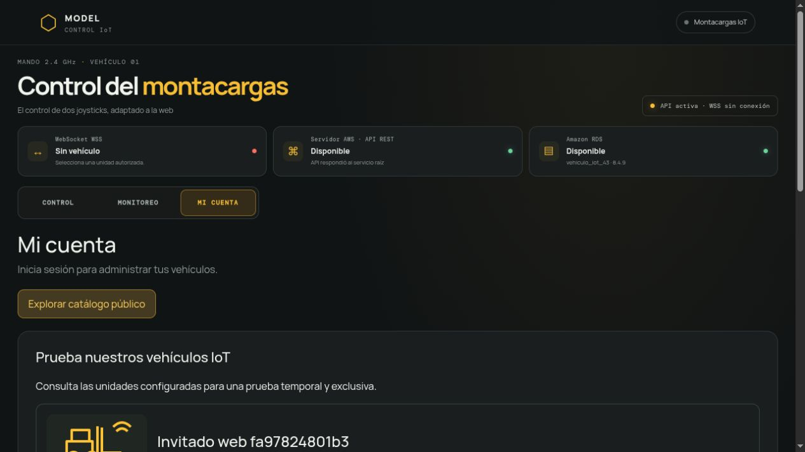

# Publicación y comprobación pública4.3 — 22 de noviembre de2026

Publicado en el repositorio original, rama main, GitHub Pages desde raíz.
Primera compilación4.3 confirmada: a30fceeb2a690951b2f1d193181f7be8fb57a175,
estado built sin error. Las actualizaciones de este documento no cambian los
contratos de la aplicación.

| Comprobación observada | Resultado |
| --- | --- |
| API HTTPS pública |4.3.0 |
| RDS desde API | conectadoTrue, vehiculo_iot_43, MySQL8.4.9 |
| Frontend publicado | sessionAuth:true y API pública; no localhost |
| Navegador, desde GitHub Pages | indicadores API/RDS disponibles y pantalla de cuenta |
| Catálogo público | modelo publicado, capacidades ADELANTE/DETENER, unidad de exhibición y SVG cargado |
| Consola al consultar catálogo | sin errores observados |
| Preflight POST con Origin de GitHub Pages | permitido para el origen exacto |
| Administración sin sesión |401 |
| WSS con token inválido | conexión disponible, cierre1008 sin entregar estado |

Estas son pruebas reales de la URL pública, fuera de las rondas de compañeros.
El modelo visible está identificado como prueba de interfaz sin hardware; no se
le atribuye movimiento físico. No se reservaron unidades ni enviaron movimientos
durante esta comprobación del agente. No se ingresaron contraseñas de aplicación.

## Prueba pública autenticada de empresa — aprobada por el alumno

Salida aportada por el alumno: `probar_publicacion_4_3.py` contra
https://34.194.45.28, con backend4.3.0 y base vehiculo_iot_43/MySQL8.4.9.
Informe privado: `cierre_4_3_0c48517ad035.json`. Las44 comprobaciones de la
secuencia terminaron correctamente:

- Altas y capacidades sobre una unidad NUEVA de software, distinta de unidad1.
- Empresa sin reserva/canal rechazada; segunda sesión no reserva, mueve ni cancela.
- Canal autenticado, movimientos del titular y DETENER aceptados.
- Demo termina solicitando DETENER y conserva historial individual sin pasos internos.
- Cierre/desconexión liberan después de DETENER.
- Catálogo/capacidades publicados, resumen real y disponibilidad que descuenta reserva.
- Invitado bloqueado mientras empresa reserva y auditoría de empresa correcta.
- Límite de login429 y limpieza de registros de prueba privados/inactivos.

Es una comprobación HTTPS/WSS real por Caddy, con credenciales introducidas
localmente en entrada oculta. No es prueba física ni sustituye los recorridos
completos de Comprador/Invitado en navegador o las rondas de compañeros.
No se sube el informe privado ni se publican contraseñas/tokens.

Pendientes: teléfono real, recorridos públicos por roles y evaluación
colaborativa. El flujo de Comprador en teléfono puede comprobar Mis vehículos,
selecciónMONT-001 y MONITOREO con WSS, sin adquirir control ni enviar movimientos.

El frontend y backend se recuperaron después de una pausa del laboratorio. Un502
se debió a backend8002 no disponible durante ese periodo; al arrancarlo de nuevo
se comprobó la API4.3 y la misma base definitiva. No se repitieron migraciones ni
se cambió de nuevo el proxy.
